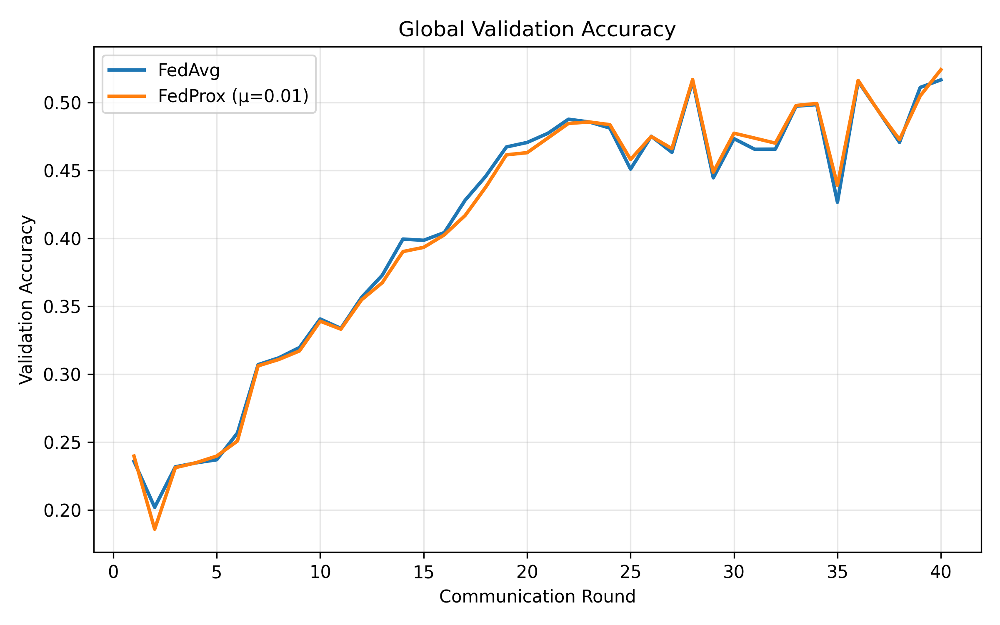
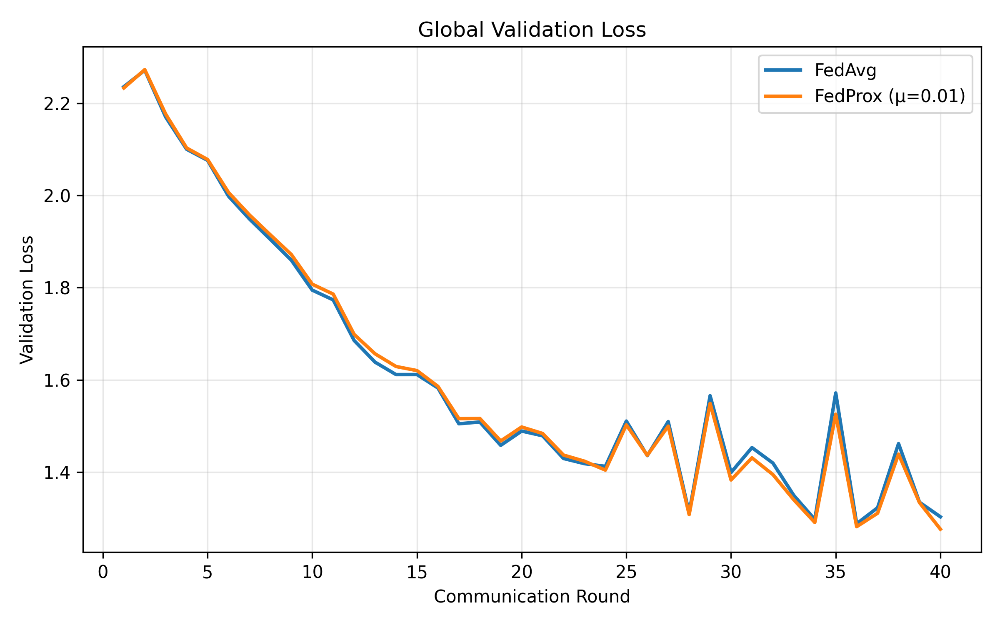
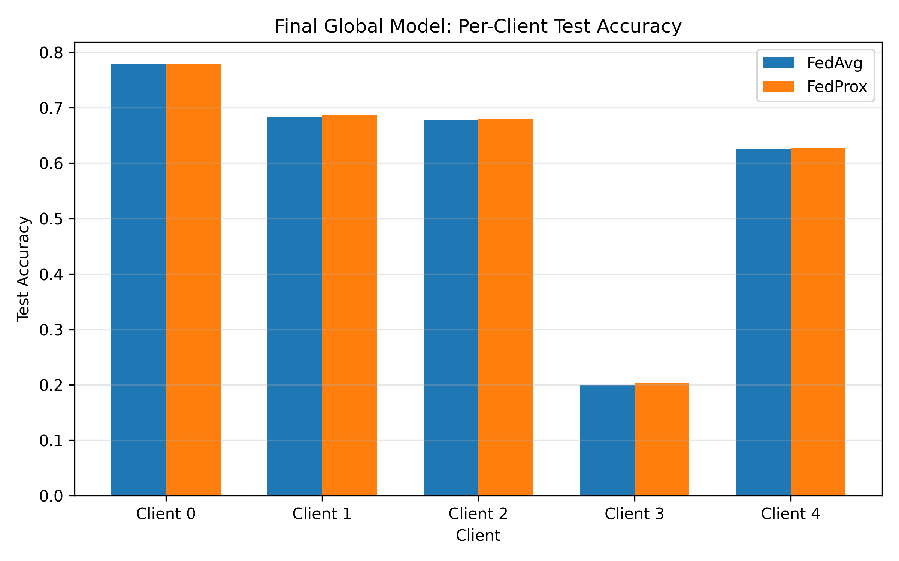

# Federated Learning on PathMNIST: FedAvg vs FedProx

A PyTorch implementation and experimental comparison of Federated Averaging (FedAvg) and Federated Proximal (FedProx) on the PathMNIST medical image classification dataset under non-IID client distributions and asymmetric client-level data quality.

## Overview

This project investigates federated learning under two practical challenges:

- **Statistical heterogeneity:** Five clients receive non-IID training data using class-wise Dirichlet partitioning (α = 0.3).
- **Label noise:** One client receives 40% symmetric label corruption to simulate imperfect local annotations.

FedAvg and FedProx are implemented and evaluated under a shared experimental configuration. The objective is to study global model performance, client-level performance, and local update behaviour.

## Experiments

| Parameter | Configuration |
|---|---|
| Dataset | PathMNIST (MedMNIST) |
| Number of classes | 9 |
| Training samples | 89,996 |
| Validation samples | 10,004 |
| Test samples | 7,180 |
| Number of clients | 5 |
| Partition strategy | Class-wise Dirichlet |
| Dirichlet α | 0.3 |
| Training partition seed | 42 |
| Test partition seed | 43 |
| Noise type | Symmetric label noise |
| Noisy client | Client 0 |
| Noise ratio | 40% |
| Communication rounds | 40 |
| Local epochs | 2 |
| Batch size | 64 |
| Optimizer | SGD |
| Learning rate | 0.01 |
| FedProx μ | 0.01 |

## Methodology

### 1. Dataset and partitioning

PathMNIST is a nine-class histopathological image classification dataset.

The official training split is distributed among five clients using class-wise Dirichlet sampling with α = 0.3.

A lower Dirichlet concentration parameter creates greater statistical heterogeneity across clients. Consequently, clients can have substantially different class distributions and dataset sizes.

Training partition seed: `42`.

### 2. Label noise injection

To simulate imperfect local annotations, symmetric label noise is introduced exclusively into Client 0.

- Noise ratio: 40%.
- Number of Client 0 training samples: 20,325.
- Number of corrupted labels: 8,130.
- Other clients: No label corruption.

Each selected label is replaced with a uniformly sampled alternative class, excluding its original class.

Original labels and corrupted training labels are retained separately.

Validation and test labels remain clean.

### 3. Client-specific evaluation

The official test split is independently partitioned into five client-specific test subsets using class-wise Dirichlet sampling with α = 0.3 and seed `43`.

The aggregated global model is evaluated on:
- The complete official test set.
- Each of the five clean client-specific test subsets.

**Evaluation caveat:** These test subsets are independently sampled from the official test set. They are diagnostic client-level slices and are not guaranteed to follow the corresponding client's training distribution.

### 4. Model architecture

A lightweight convolutional neural network is used for nine-class classification.

Architecture:

1. Conv2D (3 → 32, kernel size 3, padding 1)
2. ReLU
3. MaxPool2D
4. Conv2D (32 → 64, kernel size 3, padding 1)
5. ReLU
6. MaxPool2D
7. Adaptive Average Pooling
8. Fully Connected Layer (64 → 9)

Total trainable parameters: **19,977**.

### 5. Federated algorithms

#### FedAvg

Each client independently trains a local model using its own dataset. The server aggregates local model parameters using sample-count-weighted averaging:

\**FedAvg aggregation:**

```text
w(t+1) = Σ [ (nₖ / n) × wₖ(t+1) ]
```

Where:
- K = number of clients.
- nₖ = number of training samples at client k.
- n = total number of training samples.
- wₖ(t+1) = locally trained model parameters of client k.

#### FedProx

FedProx adds a proximal regularization term to the local training objective:

**FedProx local objective:**

```text
min_w [ Fₖ(w) + (μ / 2) × ||w - w(t)||² ]
```

Where:
- Fₖ(w) = local empirical objective at client k.
- w(t) = global model parameters at the beginning of the communication round.
- μ = proximal regularization coefficient.


Experiment configuration: **μ = 0.01**.

## Results

### Global performance

| Metric | FedAvg | FedProx |
|---|---:|---:|
| Final validation accuracy | 51.66% | 52.41% |
| Final test accuracy | 58.79% | 59.05% |
| Final test loss | 1.1685 | 1.1619 |
| Macro F1-score | 43.74% | 44.17% |
| Weighted F1-score | 52.39% | 52.70% |

FedProx achieved a 0.75 percentage-point improvement in final validation accuracy and a 0.26 percentage-point improvement in test accuracy in this experiment.

These results represent one experimental seed and should not be interpreted as evidence of statistically significant superiority.

### Client-level test accuracy

The following values represent the aggregated global model evaluated on each clean client-specific test subset.

| Client | FedAvg | FedProx |
|---|---:|---:|
| Client 0 | 77.84% | 77.98% |
| Client 1 | 68.39% | 68.65% |
| Client 2 | 67.73% | 68.04% |
| Client 3 | 20.01% | 20.42% |
| Client 4 | 62.54% | 62.69% |

Client 3 exhibits substantially lower accuracy than the other clients. Its independently generated test subset contains 377 Cancer-associated Stroma samples, whereas its training partition contains only 2 samples of that class. This mismatch is an important consideration when interpreting its performance.

### Classification observations

Both algorithms struggle with certain classes.

In particular, Cancer-associated Stroma receives an F1-score of zero for both models. Lymphocytes also exhibit high precision but low recall.

This indicates that overall accuracy alone does not fully capture class-wise performance.

## Visualizations

### Global validation accuracy



### Global validation loss



### Client-level test accuracy



## Federated update diagnostics

For each client, the local model update is defined as:

Δₖ = wₖ(t+1) − w(t)

The experiment also tracks:

- **Update norm:** Euclidean norm of the local parameter update.
- **Cosine similarity:** Directional alignment between the local update and the sample-weighted aggregate update.

These diagnostics help examine client drift and differences in local optimization behaviour under non-IID data and label noise.

## Experiment tracking

All 40-round historical metrics for both algorithms were uploaded to Weights & Biases.

**W&B Project:** (https://forge.coreweave.com/wandb/gambee-thapar-university/pathmnist-federated-learning?nw=nwusergambee)

The tracked metrics include global validation accuracy and loss, client-level test accuracy and loss, local update norms, cosine similarities, and aggregate update norms.

Note: The metrics were uploaded retrospectively from the completed experiment histories.

## Repository structure

```text
PathMNIST-FL/
│
├── README.md
├── .gitignore
├── requirements.txt
│
├── notebooks/
│   └── pathmnist_federated_learning.ipynb
│
├── configs/
│   └── experiment_config.json
│
├── results/
│   ├── figures/
│   └── reports/
│
├── artifacts/
│   ├── fedavg_final.pth
│   ├── fedprox_final.pth
│   ├── fedavg_history.pkl
│   └── fedprox_history.pkl
│
├── src/
└── data/
```

Dataset files are excluded from version control and can be downloaded using MedMNIST.

## Reproducibility

The implementation is provided in the Jupyter notebook:

`notebooks/pathmnist_federated_learning.ipynb`

The experiment configuration is available in:

`configs/experiment_config.json`

The notebook contains the dataset preparation, client partitioning, label-noise injection, model implementation, federated training, aggregation, and evaluation workflow.

## Limitations and future work

1. Results currently represent a single random seed. Multiple seeds are needed to assess variability and robustness.
2. The experiment uses one CNN architecture and one FedProx μ value.
3. The independently partitioned client test subsets do not necessarily match their corresponding client training distributions.
4. Class-wise performance remains uneven, particularly for Cancer-associated Stroma and Lymphocytes.
5. A controlled clean-versus-noisy Client 0 ablation would help isolate the effect of label corruption.

Potential future extensions include multiple-seed experiments, FedProx hyperparameter analysis, class-wise confusion matrices, and controlled label-noise ablations.

## Acknowledgements

- MedMNIST / PathMNIST dataset.
- PyTorch framework.
- Weights & Biases for experiment tracking.

---

**Research focus:** Federated optimization under statistical heterogeneity and client-level label noise.